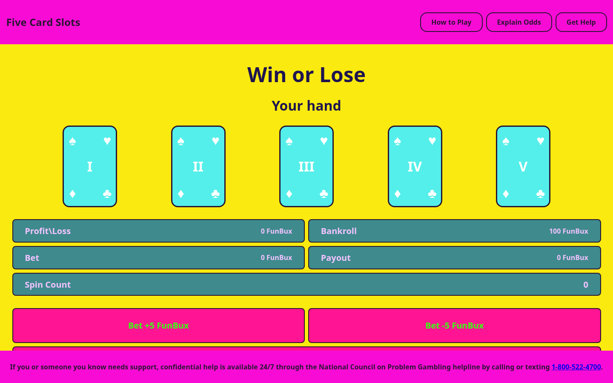

# Five Card Slots

A browser-based five-card game that combines poker-hand probabilities with a slot-machine-style interface using fictional FunBux.

## Overview

Five Card Slots lets a player choose a target poker hand, set a fictional FunBux bet, and generate a random five-card hand.

The application compares the generated cards with the selected hand, calculates the fictional payout from the displayed odds, and tracks bankroll, profit or loss, payout, and spin count across rounds.

## Features

- Select a target poker hand
- Increase or decrease a fictional FunBux bet
- Generate five unique random cards
- Check generated cards against poker-hand patterns
- Calculate fictional payouts from displayed odds
- Track bankroll, profit or loss, payout, and spin count
- Display poker-hand combinations, probabilities, and odds
- Separate How to Play and Explain Odds pages

## Technologies

<p>
  <a href="https://developer.mozilla.org/en-US/docs/Web/HTML" title="HTML">
    
  </a>
  &nbsp;
  <a href="https://developer.mozilla.org/en-US/docs/Web/CSS" title="CSS">
    
  </a>
  &nbsp;
  <a href="https://developer.mozilla.org/en-US/docs/Web/JavaScript" title="JavaScript">
    
  </a>
</p>

## How to Run

1. Clone the repository:

```bash
git clone https://github.com/nilesleesmith/just-a-fun-little-slot-machine-game.git
```

2. Open the project folder.

3. Open `index.html` in a web browser.

No additional packages or build steps are required.

## Game Currency

The game uses fictional FunBux only. It does not accept deposits, withdrawals, cash prizes, or anything of monetary value.

The interface also includes a link to gambling-support resources.

## Live Site

https://nilesleesmith.github.io/just-a-fun-little-slot-machine-game/

## Screenshots



## Gambling Disclaimer

This project is a programming exercise created for educational and entertainment purposes only.

It does **not** involve real money, real gambling, cash prizes, deposits, withdrawals, or anything of monetary value. Any currency, bets, winnings, losses, or payouts shown in the game are fictional and exist only inside the application.

The project is intended to demonstrate programming concepts such as JavaScript logic, randomization, game state, probability, conditional statements, and user interaction.

It should not be used as a gambling platform or as encouragement to gamble with real money.

## Gambling Help

Gambling can become harmful when it begins affecting your finances, relationships, work, school, or well-being.

If gambling is causing problems for you or someone you know, support is available.

### United States

**Gamblers Anonymous**

Gamblers Anonymous offers in-person, virtual, and telephone meetings for people who want help with a gambling problem.

National Hotline:

**855-222-5542**

### Practical Safety Steps

- Stop depositing additional money into gambling accounts.
- Avoid trying to recover previous losses by gambling more.
- Set limits or block access to gambling services.
- Ask a trusted person to help manage access to money temporarily.
- Contact your bank or gambling provider about available gambling-blocking tools.
- Seek support from a qualified counselor or gambling-support organization.

### Emergency Situations

If gambling-related distress is creating an immediate risk of harm to yourself or someone else, contact your local emergency service or crisis-support service immediately.
